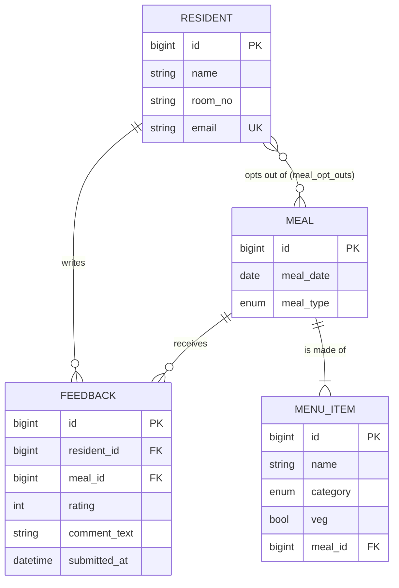
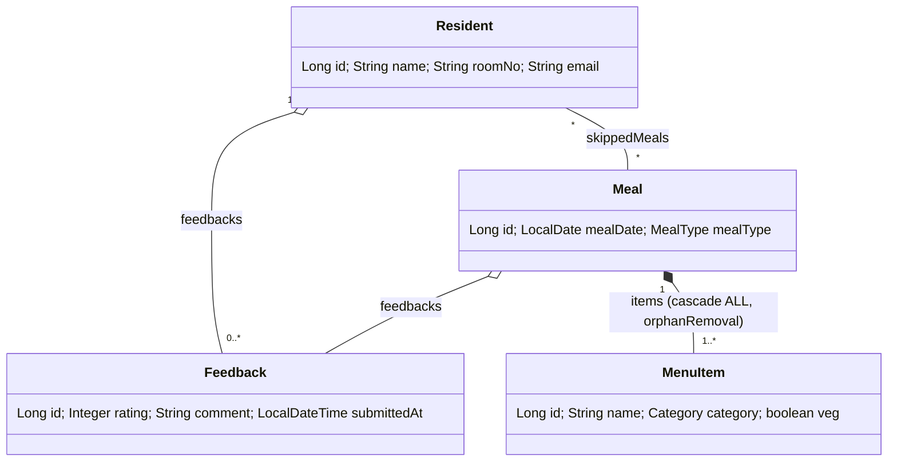

# MessMate: Hostel Mess Menu and Feedback Tracker

Spring Boot 3.3 | Java 17 | MySQL 8 | Maven | static HTML/CSS/JS

## Run it
1. Start MySQL 8. Default login in `application.properties` is `root` / `root` (override with env vars `DB_USER`, `DB_PASSWORD`, `DB_HOST`). The `messmate` database is created automatically.
2. `mvn spring-boot:run`
3. Open http://localhost:8080 (UI) or http://localhost:8080/swagger-ui.html (Swagger).

On first run `messmate.seed=true` loads 8 residents plus last week's and this week's menus, ratings and opt-outs. Set it to `false` for an empty database.

## Architecture (layered)
```
static UI  ->  Controller  ->  Service  ->  Repository  ->  MySQL
(fetch)        (REST, @Valid)   (business     (Spring Data     (JPA entities)
                                 rules)        JpaRepository)
                    \-> GlobalExceptionHandler (@RestControllerAdvice) -> clean JSON errors
```
| Layer | Package | Job |
|---|---|---|
| Controller | `controller` | URLs, HTTP verbs, status codes, `@Valid`. No logic. |
| Service | `service` | All business rules and transactions. |
| Repository | `repository` | Queries only. |
| Entity | `entity` | Tables and relationships. |
| DTO | `dto` | Request/response shapes + bean validation. Entities never leave the service layer. |
| Exception | `exception` | `ApiException` for rule violations, one global handler. |

## ER diagram

Unique keys: `meals(meal_date, meal_type)`, `feedback(resident_id, meal_id)`, `residents(email)`.

## Class diagram (entities)


## Business rules and where they are enforced
| Rule | Enforced in | Response |
|---|---|---|
| One feedback per resident per meal per day | `FeedbackService.submit` (checked before save) + unique key as safety net | 409 |
| Opted-out meals are excluded from headcount | `ReportService.headcount` = residents minus opt-outs | n/a |
| Opted-out meal cannot be rated | `FeedbackService.submit` | 409 |
| Rating must be 1 to 5 | `@Min/@Max` on DTO | 400 with field message |
| Meal not yet served cannot be rated | `FeedbackService.submit` | 400 |
| One meal per date + type | `MealService.create/update` + unique key | 409 |
| Cannot skip a finished meal, or one already rated | `OptOutService.skip` | 400 / 409 |
| Unknown ids, bad JSON, bad dates, bad enums | `GlobalExceptionHandler` | 404 / 400 |

## Endpoints
| Feature | Endpoint |
|---|---|
| 1. Create/update weekly menu | `POST /api/meals`, `PUT /api/meals/{id}`, `GET /api/meals?weekStart=`, `DELETE /api/meals/{id}` |
| 2. Rate a meal | `POST /api/feedback`, `PUT/DELETE /api/feedback/{id}`, `GET /api/feedback?mealId=&residentId=` |
| 3. Average per meal and per day | `GET /api/reports/averages?weekStart=` |
| 4. Low-rated meals for a week | `GET /api/reports/low-rated?weekStart=&threshold=3.0` |
| 5. Opt-out (skip) | `POST /api/opt-outs`, `DELETE /api/opt-outs?residentId=&mealId=`, `GET /api/opt-outs?residentId=` |
| Headcount | `GET /api/reports/headcount?date=` |
| Residents CRUD | `/api/residents` |
| Go further: dashboard, search | `GET /api/reports/dashboard`, `GET /api/menu-items?q=&category=` |

## Questions to be ready for
1. **Why DTOs?** Entities have lazy relations and back-references; exposing them causes infinite JSON loops and leaks the schema. DTOs are the API contract.
2. **Why check rules in the service and not only the DB?** The DB would throw an ugly constraint error after the fact. The service checks first and returns a clear message; the unique key still protects against two simultaneous requests.
3. **Who owns the opt-out relationship?** `Resident` (`@JoinTable`); `Meal.skippedBy` is the inverse (`mappedBy`). That is why `MealService.delete` removes the join rows manually.
4. **`cascade` and `orphanRemoval`?** Items belong to a meal: `ALL` + orphanRemoval means updating a menu replaces items and deleting a meal deletes them. Feedback uses `REMOVE` only.
5. **Why `open-in-view=false`?** Lazy loading must happen inside the service transaction, not in the web layer. Mapping to DTOs happens inside `@Transactional`.
6. **Why `@Transactional(readOnly = true)` on the class?** Read methods skip dirty checking; write methods override with `@Transactional`.
7. **Why `LAZY` on `@ManyToOne`?** The default (EAGER) loads related rows even when not needed.
8. **Average per day** is the mean of all ratings for that day's meals (not the mean of the three meal averages).
9. **"Low-rated"** means average below the threshold (default 3.0). Meals nobody rated are not listed.
10. **Which HTTP codes and why?** 201 created, 204 deleted, 400 invalid input, 404 missing id, 409 rule conflict.
